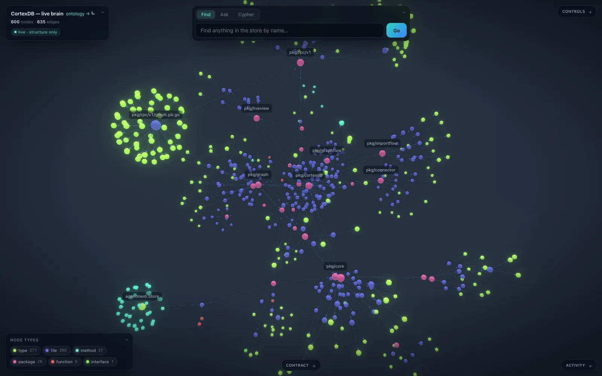

# CortexDB

[](https://pkg.go.dev/github.com/liliang-cn/cortexdb/v2) [](https://github.com/liliang-cn/cortexdb/actions/workflows/ci.yml) [](https://codecov.io/gh/liliang-cn/cortexdb) [](https://opensource.org/licenses/MIT)

AI memory and a knowledge graph in one SQLite file. Pure Go, no service to run, works without an embedding model.



## Install

| | |
| --- | --- |
| Go library | `go get github.com/liliang-cn/cortexdb/v2` |
| Claude Code | `/plugin marketplace add liliang-cn/cortexdb`, then `/plugin install cortexdb@cortexdb` |
| Codex | `codex plugin marketplace add liliang-cn/cortexdb && codex plugin add cortexdb@cortexdb` |
| Claude Code mod (optional) | `/plugin install cortexdb-live@cortexdb` |
| DeepSeek Harness | `dsh plugin --profile web add "github:liliang-cn/cortexdb#semver:^2&path:/plugins/dsh-cortexdb-memory"` ([guide](plugins/dsh-cortexdb-memory/README.md)) |
| Obsidian | unzip a release's `cortexdb-obsidian.zip` into `<vault>/.obsidian/plugins/` ([guide](plugins/obsidian-cortexdb/README.md)) |
| Shared-brain server | `go install github.com/liliang-cn/cortexdb/v2/cmd/cortexdb-grpc@latest` |
| Clients | `cargo add cortexdb-client` · `pip install cortexdb-client` · `npm install cortexdb-client` |

## Use

```go
db, _ := cortexdb.Open(cortexdb.DefaultConfig("brain.db"))
defer db.Close()
brain := db.KnowledgeMemory()
_, _ = brain.Remember(ctx, cortexdb.KnowledgeMemoryRememberRequest{MemoryID: "alice-tabs", UserID: "alice", Scope: "user", Content: "Alice prefers tabs."})
rec, _ := brain.Recall(ctx, cortexdb.KnowledgeMemoryRecallRequest{Query: "what does Alice prefer?", UserID: "alice"})
fmt.Println(rec.ContextPack.Text)
```

The plugin gives Claude Code and Codex one global brain at `~/.cortexdb/cortexdb.db`, `/remember`, `/recall` and an auto-recall hook. A session starts with an index of what the brain knows about its project, an agent about to open a file is told what happened to it before, and a session's durable facts are captured with `<private>` text and credentials kept out. Point several agents or machines at one `cortexdb-grpc` and they share the same memory and graph.

In Codex, review and trust the plugin hooks in `/hooks` to activate automatic
recall. See the [plugin guide](plugins/cortexdb/README.md) for setup and
`cortexdb-mcp --doctor --self-test` diagnostics (v2.119.0+).

## Claude Code mod

`cortexdb-live` is an optional [mod](https://code.claude.com/docs/en/plugins/mods/overview) that runs inside Claude Code on top of the `cortexdb` plugin. Install it after the plugin:

```
/plugin install cortexdb-live@cortexdb
```

The mod calls three of the plugin's tools itself, and a hook gets no permission prompt, so allow them once in `~/.claude/settings.json` (not needed in bypass mode):

```json
"permissions": {
  "allow": [
    "mcp__plugin_cortexdb_cortexdb__knowledge_memory_recall",
    "mcp__plugin_cortexdb_cortexdb__graph_statistics",
    "mcp__plugin_cortexdb_cortexdb__memory_save"
  ]
}
```

Without them the status line names the missing rules.

- **Planned recall.** Before the brain is searched, haiku turns each prompt into keywords in Chinese and English, aliases, entity names and a retrieval mode. A bare "ok" or "go ahead" searches nothing. The band above the prompt shows what was recalled; expand it to see the plan and every hit. Hide lasts until the next recall; `/cortexdb-show` brings the hidden one back.
- **Status line.** Which brain the session uses, its node count and how long the last recall took, or why the brain can't be reached.
- **Capture.** 90 seconds after a session goes idle, haiku distils the new part of the conversation into durable memories (`auto:<session>:<slug>`). Each later pass replaces a memory under the same slug rather than adding a copy. Older memories a new one makes untrue (a host moved, a decision reversed) are marked superseded: kept, but no longer recalled as current.

Haiku runs on Claude Code's own model access, so no API key is needed. Language: `/config` → `cortexdb-live` → `language` (`auto`, `zh`, `en`). The mod honours the plugin's own switches: `cortexdb-recall --disable` and `cortexdb-session-end --disable` turn recall and capture off for both. While the mod runs, the plugin's shell recall and capture hooks stand down, so nothing is done twice. Codex keeps those hooks. Mods are an early-access Claude Code feature.

## What's inside

- Vectors (HNSW, IVF, flat, binary codes), FTS5 full-text search, hybrid and graph retrieval
- `EmbeddedConfig` for small devices: an SQ8 index, bounded SQLite caches, snapshots that survive a power cut — 100k 768-d vectors open in 0.28 s with a 193 MB heap
- RAG knowledge, scoped agent memory, context packs with sources — memories say whether they were verified or are a guess, and recall keeps the two apart
- RDF 1.2 knowledge graph: SPARQL 1.1/1.2, RDFS + OWL 2 RL inference, SHACL Core + SHACL-SPARQL, RDF/XML import — passing the W3C SPARQL 1.1/1.2, RDF 1.2 (Turtle, TriG, N-Triples, N-Quads, RDF/XML) and SHACL test suites; RDFS and OWL 2 RL are covered by the repo's own tests — and read-only Cypher
- Palantir-style ontology with governed actions
- 100+ tools, in-process or over MCP
- `serve_graph_3d`: a live 3D view to find, ask, query and expand, on desktop or phone — or the same brain as a library, each memory a book on its project's shelf
- `import_agent_memory`: bring in what Claude Code, Codex and DeepSeek Harness already remember — memory notes, `CLAUDE.md` / `AGENTS.md`, Codex's memories, and optionally past sessions distilled into memories — into a local or shared brain
- Change feed: every committed write, in order, exactly once
- Observability: a request id and a W3C trace (`traceparent`) from MCP through gRPC to the trace and the recall log, recalls that explain themselves and say when they were degraded, embedder health in `/metrics` and `/healthz`, and an opt-in recall log with a `/recalls` page
- SQLite by default, PostgreSQL + pgvector with a `postgres://` DSN

## Environment

| Variable | Meaning |
| --- | --- |
| `CORTEXDB_PATH` | Database file (default `~/.cortexdb/cortexdb.db`) |
| `CORTEXDB_REMOTE` | Use a shared `cortexdb-grpc` at `host:port` (plaintext) or `https://host` (TLS, behind a proxy) instead of a local file |
| `CORTEXDB_GRPC_TOKEN` | Bearer token for that server |
| `CORTEXDB_GRPC_ADDR` | Server listen address (default `127.0.0.1:47821`) |
| `CORTEXDB_EMBED_BASE_URL` / `CORTEXDB_EMBED_API_KEY` | `cortexdb-mcp-stdio`: OpenAI-compatible embeddings endpoint and its key (fall back to `OPENAI_BASE_URL` / `OPENAI_API_KEY`); unset = lexical mode |
| `OPENAI_BASE_URL` / `OPENAI_API_KEY` | Server: the embeddings endpoint and key (`cortexdb-grpc` reads only these, not `CORTEXDB_EMBED_BASE_URL`); unset = lexical mode |
| `CORTEXDB_EMBED_MODEL` / `CORTEXDB_EMBED_DIM` | Embedding model and dimension, for both (default `text-embedding-3-small` / `1536`) |
| `CORTEXDB_REVIEW_GATE` | Server and `cortexdb-mcp-stdio`: `1` leaves proposed and rejected documents and memories out of search and recall (default off; a curation filter, not access control) |
| `CORTEXDB_SLOW_MS` | Server: log calls slower than this, with the time each stage took (default `1000`, `0` = none) |
| `CORTEXDB_TRACE` / `CORTEXDB_TRACE_FILE` | Server: log every call; also append the records to a JSON-lines file |
| `CORTEXDB_LOG_FORMAT` / `CORTEXDB_LOG_LEVEL` | Server: `text` (logfmt, default) or `json`; `debug`, `info` (default), `warn`, `error` |
| `CORTEXDB_TRACE_MAX_MB` / `CORTEXDB_TRACE_KEEP` / `CORTEXDB_TRACE_MAX_AGE_DAYS` | Server: rotate the trace file at this size (`100`), keep this many old files (`5`) for at most this many days (`30`) |
| `CORTEXDB_EMBED_PROBE_SECONDS` | Server: probe the embedder this often, for `/healthz` and `/metrics` (default `60`, `0` = off) |
| `CORTEXDB_RECALL_LOG` | Server and `cortexdb-mcp-stdio`: `1` keeps a log of recalls — queries included — for the `/recalls` page and the `recall_log_*` tools (default off) |
| `CORTEXDB_RECALL_LOG_DAYS` / `CORTEXDB_RECALL_LOG_MAX_ROWS` | How long (`30` days) and how many (`100000`) recalls the log keeps |

## Docs

[Website](https://liliang-cn.github.io/cortexdb/) · [Guide](docs/GUIDE.md) (full feature reference) · [Examples](examples/README.md) · [Changelog](CHANGELOG.md) · [中文](README_CN.md)

## License

MIT
