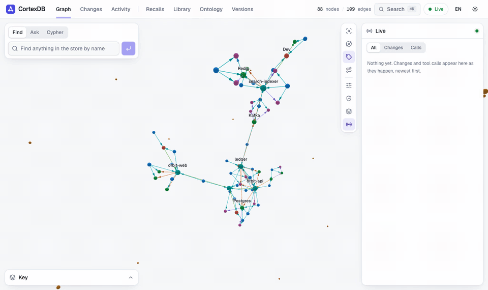

# CortexDB

[](https://pkg.go.dev/github.com/liliang-cn/cortexdb/v2) [](https://github.com/liliang-cn/cortexdb/actions/workflows/ci.yml) [](https://codecov.io/gh/liliang-cn/cortexdb) [](https://opensource.org/licenses/MIT)

Memory your coding agents share. Tell Claude Code something once, and Codex, your other machines and next week's session already know it.



## Install

Claude Code:

```
/plugin marketplace add liliang-cn/cortexdb
/plugin install cortexdb@cortexdb
```

Codex:

```
codex plugin marketplace add liliang-cn/cortexdb && codex plugin add cortexdb@cortexdb
```

Go:

```
go get github.com/liliang-cn/cortexdb/v2
```

Also for [DeepSeek Harness](plugins/dsh-cortexdb-memory/README.md), [Obsidian](plugins/obsidian-cortexdb/README.md), and Rust, Python and Node clients (`cortexdb-client`).

## What you get

- **Agents remember.** Preferences, decisions and project facts are captured as you work and recalled before the next prompt.
- **One brain, many agents.** Point every agent and machine at one `cortexdb-grpc` server and they share it.
- **See what it knows.** A live web view of the graph, every recall and every change, on desktop or phone.
- **No model required.** Works without an embedding model; add one for semantic search.
- **A real knowledge graph.** SPARQL, Cypher, ontology, inference and history, if you want to go deeper.

## In Go

```go
db, _ := cortexdb.Open(cortexdb.DefaultConfig("brain.db"))
brain := db.KnowledgeMemory()
brain.Remember(ctx, cortexdb.KnowledgeMemoryRememberRequest{MemoryID: "tabs", UserID: "alice", Content: "Alice prefers tabs."})
rec, _ := brain.Recall(ctx, cortexdb.KnowledgeMemoryRecallRequest{Query: "what does Alice prefer?", UserID: "alice"})
fmt.Println(rec.ContextPack.Text)
```

## Docs

[Guide](docs/GUIDE.md) · [Plugin](plugins/cortexdb/README.md) · [Live view](docs/GUIDE.md#the-live-view) · [Claude Code mod](docs/GUIDE.md#claude-code-mod) · [Environment variables](docs/GUIDE.md#environment) · [Integrating your agent](docs/INTEGRATION.md) · [Examples](examples/README.md) · [Changelog](CHANGELOG.md) · [中文](README_CN.md)

MIT
