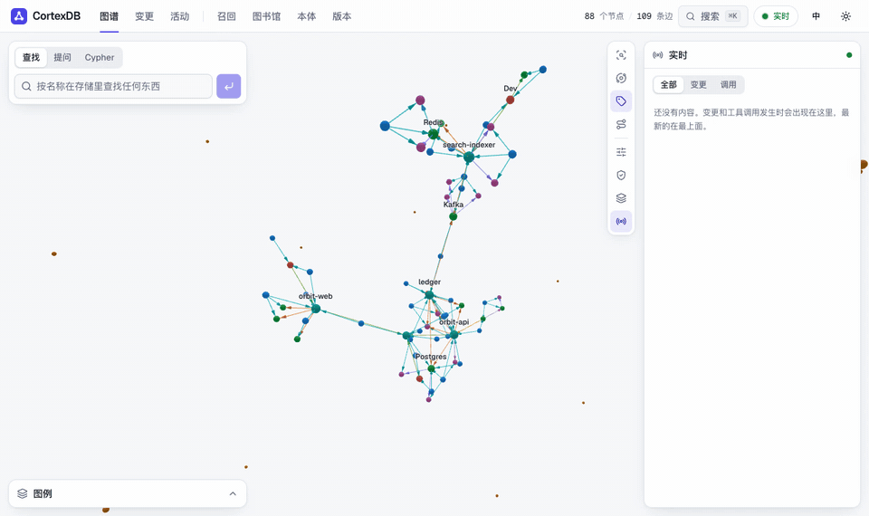

# CortexDB

[](https://pkg.go.dev/github.com/liliang-cn/cortexdb/v2) [](https://github.com/liliang-cn/cortexdb/actions/workflows/ci.yml) [](https://codecov.io/gh/liliang-cn/cortexdb) [](https://opensource.org/licenses/MIT)

让你的编程 agent 共用一份记忆。跟 Claude Code 说一次，Codex、你的其他机器、下周的新会话就都知道了。



## 安装

Claude Code：

```
/plugin marketplace add liliang-cn/cortexdb
/plugin install cortexdb@cortexdb
```

Codex：

```
codex plugin marketplace add liliang-cn/cortexdb && codex plugin add cortexdb@cortexdb
```

Go：

```
go get github.com/liliang-cn/cortexdb/v2
```

另有 [DeepSeek Harness](plugins/dsh-cortexdb-memory/README.md)、[Obsidian](plugins/obsidian-cortexdb/README.md) 插件，以及 Rust、Python、Node 客户端（`cortexdb-client`）。

## 能做什么

- **agent 记得住。** 偏好、决定、项目里的事实边做边记，下一次提问前自动召回。
- **一个大脑，多个 agent。** 所有 agent 和机器连同一个 `cortexdb-grpc`，共用一份记忆。
- **看得见它记了什么。** 网页实时视图：图谱、每一次召回、每一处改动，手机上也能看。
- **不需要模型。** 没有 embedding 模型也能用；接上模型就有语义检索。
- **真正的知识图谱。** SPARQL、Cypher、本体、推理、历史版本，想深入就有。

## 在 Go 里用

```go
db, _ := cortexdb.Open(cortexdb.DefaultConfig("brain.db"))
brain := db.KnowledgeMemory()
brain.Remember(ctx, cortexdb.KnowledgeMemoryRememberRequest{MemoryID: "tabs", UserID: "alice", Content: "Alice 喜欢用 tab。"})
rec, _ := brain.Recall(ctx, cortexdb.KnowledgeMemoryRecallRequest{Query: "Alice 喜欢什么？", UserID: "alice"})
fmt.Println(rec.ContextPack.Text)
```

## 文档

[指南](docs/GUIDE_CN.md) · [插件](plugins/cortexdb/README.md) · [实时视图](docs/GUIDE_CN.md#实时视图) · [Claude Code mod](docs/GUIDE_CN.md#claude-code-mod) · [环境变量](docs/GUIDE_CN.md#环境变量) · [接入你的 agent](docs/INTEGRATION_CN.md) · [示例](examples/README.md) · [更新日志](CHANGELOG.md) · [English](README.md)

MIT
